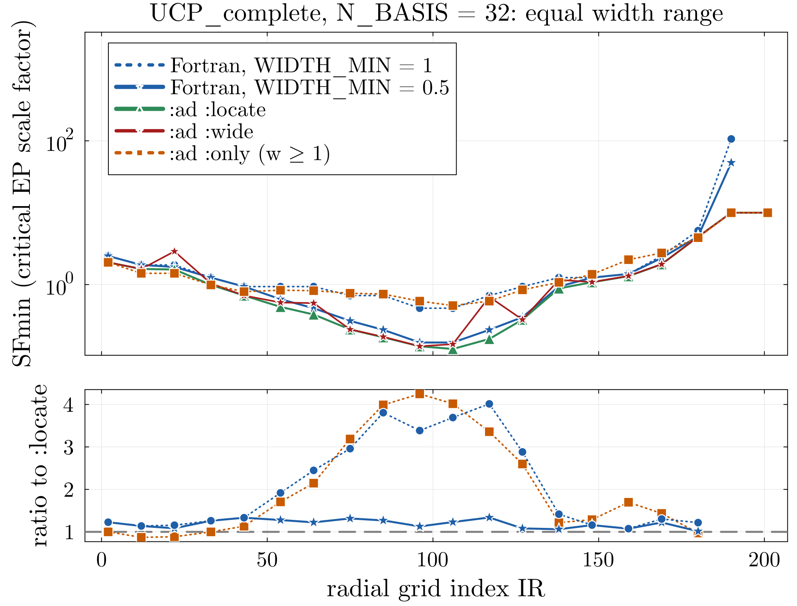
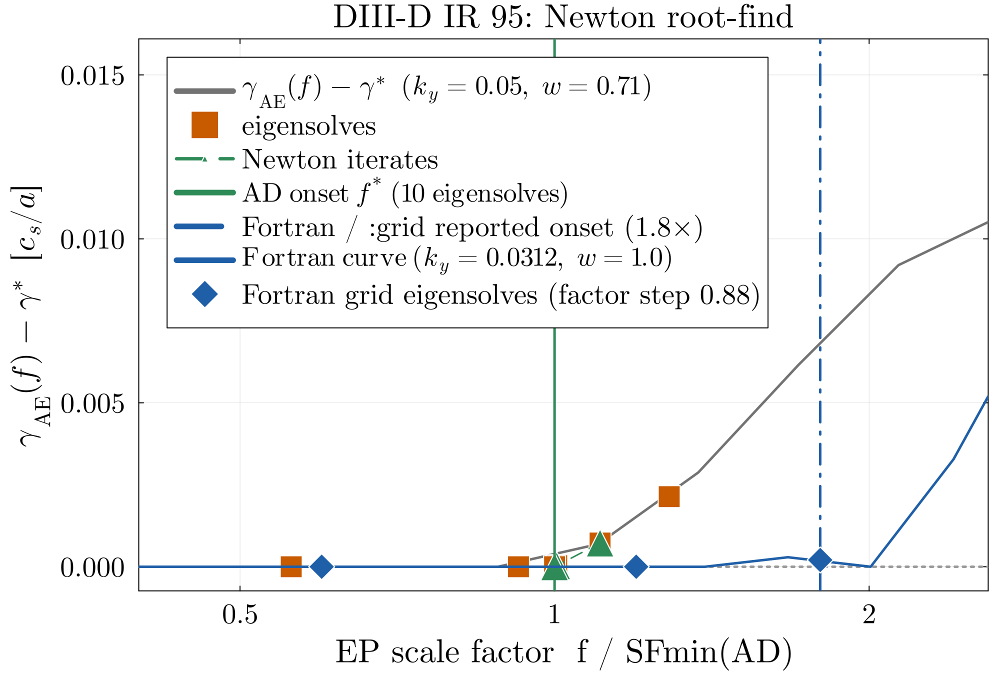
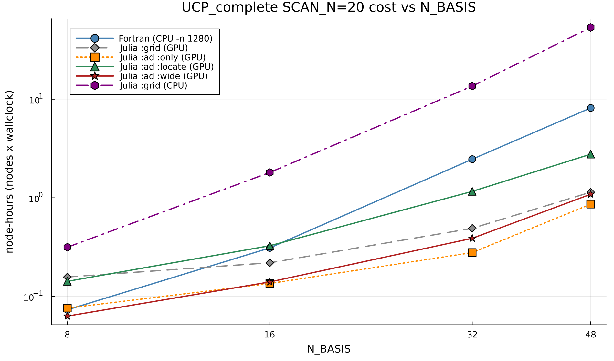

[](https://codecov.io/github/projecttorreypines/tglfep.jl)


# TGLFEP.jl

**TGLFEP.jl** is the Julia implementation of **TGLF-EP**, the energetic-particle (EP) critical-gradient threshold model
built on [TGLF.jl](https://github.com/ProjectTorreyPines/TGLF.jl).
TGLFEP.jl scans a scale factor on the EP pressure gradient until a marginally unstable Alfvénic
mode appears, yielding the critical EP density/pressure gradients used for EP transport and
stability studies.

It is a close, jointly-maintained translation of the Fortran GACODE add-on `TGLF-EP`
(verified against it bit-for-bit), and adds a **CUDA GPU eigensolver** plus Julia-native
**autodiff (`ad`) solvers**. On the reactor-relevant `UCP_complete` case these make TGLFEP.jl
~5–9× cheaper in node-hours than the fully MPI-parallel Fortran CPU reference at
`N_BASIS=32`, and the `ad` solvers resolve the narrower-width (`0.5 ≤ w < 1`) EP-driven Alfvén modes
that Fortran misses at its default `WIDTH_MIN=1` floor. No width search goes below the TGLF-EP
ballooning-width physics floor `WIDTH_FLOOR = 0.5` (see
`docs/AD_SOLVERS_AND_SEARCH_BOUNDS.md`).

**Which solver?** Two axes: match Fortran or improve on it; faithful value or faster approximation.

|                                          | Faithful                                       | Faster approximation                          |
| ---------------------------------------- | ---------------------------------------------- | --------------------------------------------- |
| **Match Fortran** (`w≥1` box)            | **`:grid`** reproduces Fortran (**~5.0×**)     | **`:ad :only`** approximates `:grid` (**~8.9×**) |
| **Extend Fortran** (adds `0.5≤w<1` AE modes) | **`:ad :locate`** *(default)* (**~2.1×**)  | **`:ad :wide`** (**~6.3×**)                    |

Multipliers are node-hours vs the fully MPI-parallel Fortran reference (`-n 1280`, 10 CPU
nodes) at `N_BASIS=32` on `UCP_complete`; the GPU advantage grows with the eigenmatrix size
(see [`docs/BENCHMARKS.md`](docs/BENCHMARKS.md)). `:ad :locate` is the production default
(also the `ActorTJLFEP` default in FUSE).

**What the extended width search changes.** Critical scale factor vs radius on the reactor
case (`UCP_complete`, `N_BASIS=32`). `:ad :only` follows stock Fortran (`WIDTH_MIN = 1`);
`:ad :locate` stays within ~1.3× of Fortran rerun with the same width range (`WIDTH_MIN = 0.5`),
where the thresholds at mid-radius are up to ~4× lower; `:ad :wide` matches `:locate` except at a few radii.



**How the `:ad` solvers find the threshold.** Instead of scanning a fixed grid of scale factors,
they solve `γ_AE(f) − γ* = 0` by Newton iteration, with the derivative from automatic
differentiation of the eigenvalue. One DIII-D radius: the root is found in 10 eigensolves, and
the grid reports the onset 1.8× higher on its coarser `(ky, w, f)` grid.



Full API reference: [online documentation](https://projecttorreypines.github.io/TGLFEP.jl/dev).

## Run it on Slurm (Perlmutter)

The templates in [`slurm/`](slurm/README.md) are the intended entry point. Pick one by device
and layout, edit the `CONFIG` block at the top (allocation, which `input.TGLFEP`, solver,
sysimage on/off), submit from the repo root:

```bash
cd TJLFEP
$EDITOR slurm/tglfep_julia_gpu_backfill.sbatch     # "#SBATCH -A <your allocation>", TGLFEP_FILE, SOLVER ...
sbatch slurm/tglfep_julia_gpu_backfill.sbatch
```

| Template | Layout | Recommended for |
|---|---|---|
| `slurm/tglfep_julia_gpu_5N.sbatch` | 5 GPU nodes, 20 radii in one wave | high throughput: `grid`, `ad :only` |
| `slurm/tglfep_julia_gpu_backfill.sbatch` | 1 GPU node, 4 GPUs drain a radius queue | low footprint, and the extended-width solvers `ad :locate`/`:wide`, `robust_ad`, `truth` |
| `slurm/tglfep_julia_cpu_10N.sbatch` | 10 CPU nodes, one worker per radius | no GPU allocation |
| `slurm/tglfep_julia_cpu_1N.sbatch` | 1 CPU node, 2 workers | smallest footprint (about 10x the 10-node wall) |

Every solver option is a labelled line in the template; the physics (`SCAN_N`, `N_BASIS`,
`WIDTH_MIN/MAX`, `FACTOR_IN`, ...) stays in the `input.TGLFEP` file, exactly as for the
Fortran driver. Each template runs with or without a prebuilt sysimage (`SYSIMAGE=""` for
JIT). [`slurm/README.md`](slurm/README.md) has the solver decision table, where outputs land,
and troubleshooting.

## Installation

Requires Julia **1.11+**. TGLFEP.jl depends on registered **TGLF.jl 2.x** (FuseRegistry); no TGLF.jl
checkout is needed.

```bash
cd TJLFEP
julia --project=. -e 'using Pkg; Pkg.instantiate(); Pkg.precompile()'
```

The GPU path requires **CUDA >= 12.6** (the eigensolver calls `cusolverDnXgeev`); on
Perlmutter `module load cudatoolkit/12.9 julia/1.11.7`.

> **Depot-path gotcha (don't clobber your home depot).** When `JULIA_DEPOT_PATH` is unset,
> Julia uses `~/.julia`. A bare `export JULIA_DEPOT_PATH=$PSCRATCH/.julia` *replaces* that
> default, so Julia silently stops seeing everything in your home depot. Prepend/append instead:
>
> ```bash
> export JULIA_DEPOT_PATH="$HOME/.julia:$PSCRATCH/.julia${JULIA_DEPOT_PATH:+:$JULIA_DEPOT_PATH}"
> ```
>
> The first entry is where Julia writes; later entries are search-only. The `slurm/` templates
> follow this rule and additionally append the shared depot a prebuilt sysimage needs
> ([`docs/SYSIMAGES.md`](docs/SYSIMAGES.md)).

A standalone container (CPU + GPU, no Julia install) is published on GHCR; see
[`deploy/container/README.md`](deploy/container/README.md).

## Quick start from Julia

```julia
using TJLFEP

# Directly from an input.gacode + scan-control input.TGLFEP:
runTHD_from_gacode("examples/DIIID_202017C42_500ms_v3.1/input.gacode",
                   "examples/DIIID_202017C42_500ms_v3.1/input_scan20_nb6.TGLFEP";
                   use_gpu=true)

# File-based TGLF-EP inputs (loaded standalone, TJLFEP stays light, no IMAS/FUSE):
runTHD("input.TGLFEP", "input.MTGLF", "input.EXPRO"; use_gpu=true)

# FUSE-native IMAS data dictionary (same gradient routines as input.gacode):
runTHD(dd, rho, OptionsDict; use_gpu=true)   # see examples/ITER/ITERstructExample.jl
```

`use_gpu` defaults to `:auto` (GPU when CUDA is functional; `true`/`false`/`:gpu`/`:cpu` force
a device). `solver=:grid|:ad|:robust_ad|:truth` and `refine_rounds` are keyword arguments on all
three; the `ad` width-extension tier is `AD_EXTEND_MODE=locate|wide|only` in the environment. One
radius of the spectrum diagnostic (`PROCESS_IN=3`) runs in minutes on a login node; see
[`docs/SPECTRUM_DIAGNOSTIC.md`](docs/SPECTRUM_DIAGNOSTIC.md).

## Repository layout

| Path | Contents |
|------|----------|
| `slurm/` | **Start here.** Slurm submit templates + the shared GPU/CPU drivers ([`slurm/README.md`](slurm/README.md)). |
| `src/` | The TGLFEP.jl package (`module TJLFEP`). |
| `ext/` | `TJLFEPIMASExt`: the IMAS/FUSE `dd` entry points, loaded automatically under FUSE. |
| `examples/` | DIII-D, UCP and ITER cases with inputs and Fortran references ([`examples/README.md`](examples/README.md)). |
| `build/` | Sysimage bakes only ([`build/README.md`](build/README.md)). |
| `deploy/` | GHCR container (lean / imas / gpu) and its Slurm smoke tests. |
| `docs/` | Benchmarks, sysimage notes, verification and reproduction notes, solver design notes. |
| `test/` | Regression tests, incl. the nb6 Fortran-match and spectrum fixtures. |
| `utils/` | Preprocessing-comparison utilities. |
| `dev/` | Maintainer material: benchmark sweeps, Fortran verification, AD research ([`dev/README.md`](dev/README.md)). |

## Verification against Fortran

The Julia port reproduces the Fortran `TGLFEP_driver` `SFmin` profile to its printed
precision on the DIII-D `202017C42_500ms_v3.1` case (`SFmin` max relative error ~0.03%,
α(dn/dr) ~0.5%). `test/runtests_regression_nb6.jl` checks one radius against the archived
Fortran golden output; the full 20-radius overlay is reproduced with the scripts in
`dev/verify/` ([`docs/REPRODUCE_FORTRAN_MATCH.md`](docs/REPRODUCE_FORTRAN_MATCH.md);
physics-parity notes in [`docs/FORTRAN_JULIA_COMPARISON.md`](docs/FORTRAN_JULIA_COMPARISON.md)).

## Benchmarks

Node-hours at `N_BASIS=32` on `UCP_complete` (20 radii, measured 2026-10 on v2.0.18 with the
`WIDTH_FLOOR = 0.5` default): Fortran `-n 1280` ≈ 2.46; `:ad :only` ≈ 0.28, `:ad :wide` ≈ 0.39,
`:grid` ≈ 0.49, `:ad :locate` ≈ 1.16; `:grid` without a GPU, on the same 10 CPU nodes as
Fortran, ≈ 2.81 (re-measured 2026-11). The GPU margin grows with `N_BASIS` (Fortran is cheaper at
8, break-even near 16, ~7–9× at 48), and stock Fortran TGLF cannot run
`N_BASIS>32` without a rebuild.



Tables, more plots, accuracy comparison and the DIII-D case:
[`docs/BENCHMARKS.md`](docs/BENCHMARKS.md), [`docs/README_DIII-D_example.md`](docs/README_DIII-D_example.md);
solver design and search bounds: [`docs/AD_SOLVERS_AND_SEARCH_BOUNDS.md`](docs/AD_SOLVERS_AND_SEARCH_BOUNDS.md).

## Citation

If this software contributes to an academic publication, please refer to it as **TGLFEP.jl** and cite it as follows:

> T.F. Neiser, D. Sun, B. Agnew, W. Hoffman, J. Towle, M. Trifoglio, S. Guizzo, J. Lestz, K. Callahan, T. Slendebroek, O. Meneghini, B.C. Lyons, A. Ghiozzi, J. McClenaghan, M. Yoo, N. Shi, S. Smith and E. Bass, _TGLFEP.jl: A GPU-accelerated, auto-differentiable Julia port of TGLF-EP for Alfvén eigenmode-driven energetic-particle transport_, APS Division of Plasma Physics Meeting Abstracts (2026), poster BP11.006
