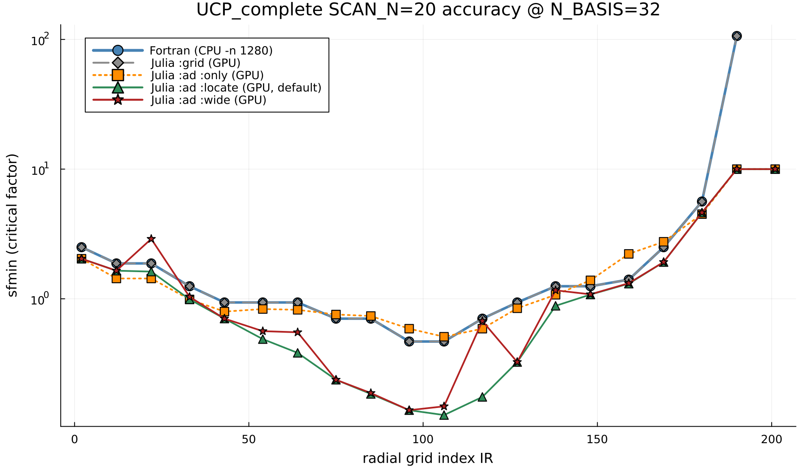
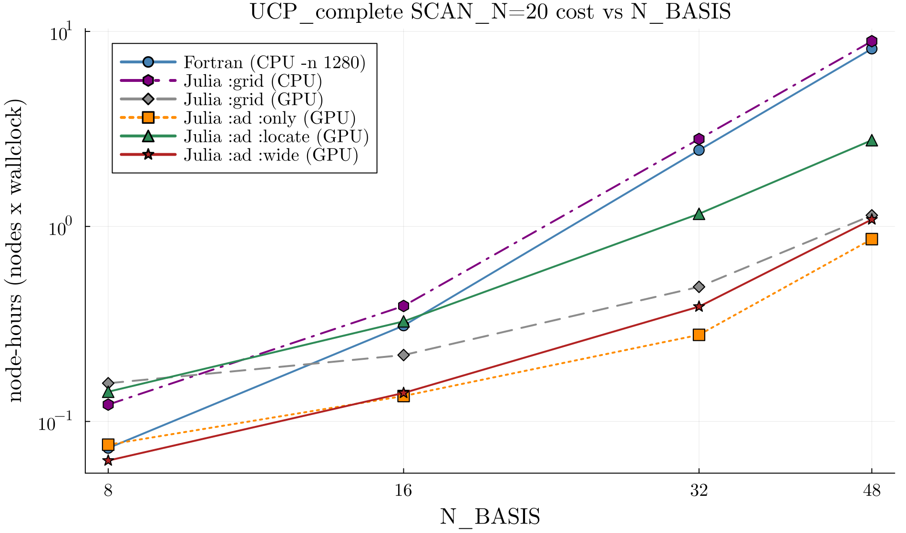

# Benchmark: cost vs N_BASIS (UCP, SCAN_N=20)

Moved here from the top-level README. Reproduction scripts live in `dev/timing/`.

Timing/accuracy on the **reactor-relevant `UCP_complete`** case (the pulsed compact-reactor use case UCR-P
of Holland et al., *J. Plasma Phys.* **89**, 905890418 (2023): 8 T, R = 4 m, 16 MA; run with D, T, He ash
and fusion alphas, i.e. 3 thermal ions + energetic particles), a 20-radius scan on Perlmutter with sysimages.
This is the headline benchmark because the GPU eigensolver's payoff scales with
the eigenmatrix size (species × `N_BASIS`): UCP's per-`ky` eigenmatrix is `2400²`
(complex) at `N_BASIS=32` vs `1440²` for DIII-D, so each eigensolve is several×
heavier and the GPU pulls decisively ahead. The smaller DIII-D verification case,
where the margin is thinner, is in
[`docs/README_DIII-D_example.md`](docs/README_DIII-D_example.md).

**Cost is reported in node-hours** (nodes × wallclock), the fair,
layout-independent metric (Fortran `-n 1280` on 10 CPU nodes, the GPU tiers on 5 or
1). Each solver runs on its fastest parallel layout (**rule of thumb: `grid` → MPS
team, `ad` → in-process threads**; an MPS team only adds overhead to `ad`).

The solvers, with node-hours vs the fully MPI-parallel Fortran (`-n 1280`) at `N_BASIS=32`:

| Solver | vs Fortran | What it computes |
| --- | ---: | --- |
| **`:ad :only`** | **~8.9×** | Approximates `:grid`: a smooth, de-quantized version of the `w≥1` result (median `:only/grid ≈ 0.9`). Fast iteration only; misses the narrower `0.5 ≤ w < 1` modes. |
| **`:ad :wide`** | **~6.3×** | Adds the narrower `0.5 ≤ w < 1` AE modes in one log-seeded pass; conservative (within ~1–2× of `:ad :locate`, never below it). Bulk NN-DB generation. |
| **`:grid`** | **~5.0×** | The verified Fortran-equivalent `(kyhat × width × factor)` sweep (thousands of eigensolves/radius). |
| **`:ad :locate`** *(default)* | **~2.1×** | Adds the narrower `0.5 ≤ w < 1` AE modes; the faithful extended-width value. Production default. |

Measured 2026-10-24…31 on Perlmutter with v2.0.18; the extended-width rows use the ballooning-width physics
floor `WIDTH_FLOOR = 0.5` that is now the code default (no width search goes below it).

The `ad` solvers are **grid-independent**: rather than reading `sfmin` off the coarse
factor grid, they locate the instability onset directly (Newton root-find with exact
forward-mode AD derivatives). `:grid`/`:ad :only` stay in the Fortran `w≥1` box;
`:ad :locate`/`:ad :wide` additionally resolve the narrower-width (`0.5 ≤ w < 1`, down to
the physics floor) EP-driven modes it excludes (the *entire* `sfmin` reduction below grid,
up to ~4× at mid-radius). Higher-fidelity internal reference tiers (`robust_ad`, and the
`nbasis`-converged `truth`) sit above `:ad :locate`, which matches them essentially
bit-for-bit; they are documented for reference in
[`docs/AD_SOLVERS_AND_SEARCH_BOUNDS.md`](https://github.com/ProjectTorreyPines/TGLFEP.jl/blob/master/docs/AD_SOLVERS_AND_SEARCH_BOUNDS.md).

**Accuracy**: `sfmin(IR)` for all solvers at `N_BASIS=32`:

`:grid` (grey) reproduces the Fortran reference (blue) bit-for-bit, and `:ad :only`
(orange) tracks it closely (the de-quantized `w≥1` value). `:ad :locate` (green) and
`:ad :wide` (dark red) drop below `grid` into the narrower-width `0.5 ≤ w < 1` modes from
IR ≈ 43 outward (1.9–4× below grid for IR 54–127, the maximum ~4× at IR 117; 1.1–1.3×
elsewhere). `:ad :wide` stays within ~1–1.8× of `:ad :locate` and never below it (its
single pass misses the located optimum at IR 117, 3.9×, and lands above `grid` at IR 22).
Colors and legend order match the node-hours plot below for quick cross-reference.

Absolute node-hours at `N_BASIS=32`, each solver on its fastest layout (Fortran
`-n 1280` on 10 CPU nodes; `grid`/`:ad :only` on 5 MPS GPU nodes; `:ad
:locate`/`:ad :wide` on a 1-node backfill with 4 GPU workers draining a 20-radius
queue): Fortran ≈2.46; `:ad :only` ≈0.28, `:ad :wide` ≈0.39, `grid` ≈0.49,
`:ad :locate` ≈1.16 — so **every GPU tier beats the fully-parallel Fortran**
(~8.9× / ~6.3× / ~5.0× / ~2.1×). Julia `:grid` on **CPU** (≈2.81, same 10 nodes as
Fortran) costs 1.14× the Fortran run, so it is the GPU eigensolver that puts the Julia
port ahead. The GPU advantage *grows* with `N_BASIS` (Fortran is cheaper at
`N_BASIS = 8`, break-even is near 16, and the GPU pulls ~5–9× ahead by 32) as the
eigenmatrix grows: at `N_BASIS=48` (Fortran ≈8.15 node-hours) the margins are
`:grid` **~7.1×** (≈1.14), `:ad :only` **~9.5×** (≈0.86), `:ad :wide` **~7.5×**
(≈1.09), `:ad :locate` **~2.9×** (≈2.77). `:ad :wide` is ~3× cheaper than
`:locate` at `N_BASIS=32` (2.5× at 48). The per-backend tables below give the raw
wallclock seconds.

**Fortran cannot run `N_BASIS>32` without recompiling.** Stock TGLF hard-caps the
Hermite basis at a compile-time `PARAMETER (nb=32)`; requesting more does **not**
error — a `put_switches` sanity check silently resets the run to the *default*
`nbasis=4`, returning garbage in seconds (the failure is only visible as an
impossibly fast run). The `N_BASIS=48` Fortran column here required rebuilding
the TGLF library with `nb=48`, `nxm=95` (a full `make clean` rebuild — the gacode
Makefile does not track Fortran module dependencies). TJLF/TJLFEP allocate the
basis dynamically, so the Julia solvers run any `N_BASIS` unmodified.

**Best-throughput layout depends on the solver** (for these `SCAN_N=20` runs):
- **`:grid` and `:ad :only` → 5 GPU nodes.** Per-radius cost is uniform, so
  spreading the 20 radii across 5 nodes (~4 radii/node) minimizes wallclock with
  no wasted node-hours.
- **`:ad :locate` and `:ad :wide` → 1 GPU node, backfill.** Their edge radii take
  much longer (the narrower-width `0.5 ≤ w < 1` locate is triggered there), so a fixed
  multi-node split would leave nodes idle waiting on the straggler edge radii.
  Running a single node with 4 workers draining a shared 20-radius claim queue
  keeps every GPU busy and gives the lowest node-hours. At `N_BASIS=48` the
  default 32-worker team OOMs the node's 256 GB host RAM, so the nb48
  `:locate`/`:wide` rows run a halved team (`MPS_TEAM=4`, 16 workers) on 80 GB
  A100 nodes (`-C gpu&hbm80g`) — the fastest layout that fits.

**Grid solver**: Fortran CPU (10 nodes, `-n 1280` = 128 ranks/node) vs Julia CPU
(10 nodes, SlurmClusterManager) vs Julia GPU (5 A100 nodes, **MPS team**):

| N_BASIS | Fortran CPU (s) | Julia CPU (s) | Julia GPU MPS (s) | GPU speedup vs Fortran (wallclock) |
|--------:|----------------:|--------------:|------------------:|-----------------------------------:|
| 8  | 26.2   | 43.8    | 113.0 | 0.23× |
| 16 | 111.5  | 140.9   | 158.0 | 0.71× |
| 32 | 886.9  | 1010.4  | 353.0 | **2.51×** |
| 48 | 2933.5 | 3208.3  | 821.0 | **3.57×** |

(Wallclock here compares a **5-node** GPU run to a **10-node** `-n 1280` Fortran run
— *half* the nodes — so it understates the GPU, yet it still wins 2.5× at
`N_BASIS=32` and 3.6× at 48; the fair node-count-normalized margins are ~5.0× and
~7.1×. Julia `:grid` on CPU, on the same 10 nodes as Fortran, takes 1.1–1.7×
the Fortran wallclock (1.67× at `N_BASIS=8`, where ~17 s of worker start-up dominates; 1.14× at
32 and 1.09× at 48), so the GPU is doing the heavy lifting. The 48
Fortran time uses the `nb=48` rebuild described above.)

**`:ad :only` (bare `w≥1` AD, no faithful confirm)**: Julia GPU (5 A100 nodes,
**in-process threads**), vs the grid GPU path (both 5-node, so this wallclock ratio is
apples-to-apples):

| N_BASIS | Grid GPU MPS (s) | `:ad :only` GPU threads (s) | `:only` vs grid-GPU (wallclock) |
|--------:|-----------------:|----------------------------:|--------------------------------:|
| 8  | 113.0 | 55.0  | 2.1× |
| 16 | 158.0 | 97.0  | 1.6× |
| 32 | 353.0 | 200.0 | **1.8×** |
| 48 | 821.0 | 620.0 | 1.3× |

`:ad :only` is ~1.6–2.1× faster than the grid MPS path in wallclock (narrowing to
~1.3× at `N_BASIS=48`, where the few-but-huge AD eigensolves stop amortizing their
serial descent): it replaces the
thousands of grid eigensolves/radius with a handful of AD Newton steps. Note this
is the *same* `ad` solver run two ways: on an **MPS team** instead of threads it is
*slower*, because the per-radius AD regions are small and the descent is sequential,
so team-spawn/remote-call overhead never amortizes. **Rule of thumb: `grid` → MPS,
`ad` → threads.**

Data: `docs/plots/ucp_scan20_timing.csv` (2026-10 campaign; the Julia CPU column was re-measured
2026-11-10 with `slurm/tglfep_julia_cpu_10N.sbatch`, after the CPU path began reusing its solver
buffers and pinning one thread per physical core). Reproduce with
`dev/timing/submit_ucp_scan20.sh` (Fortran `-n 1280` + all GPU tiers). The
smaller DIII-D verification case (bit-for-bit Fortran match) is in
[`docs/README_DIII-D_example.md`](docs/README_DIII-D_example.md).
