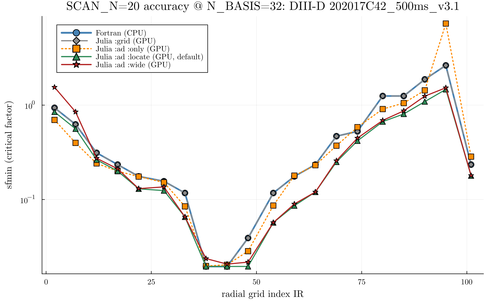
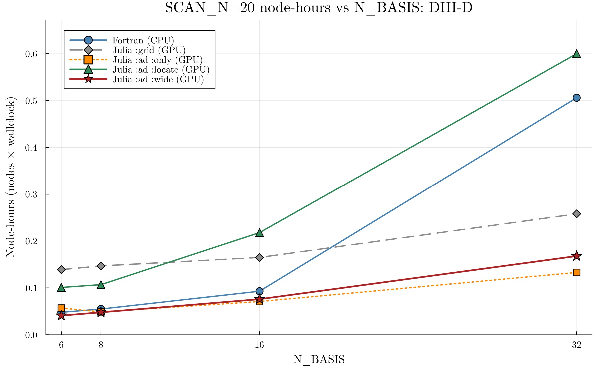

# DIII-D benchmark: cost vs N_BASIS (`202017C42_500ms_v3.1`, SCAN_N=20)

This is the timing/accuracy benchmark for the **DIII-D** `202017C42_500ms_v3.1`
case — the small, single-thermal-ion verification case used for the bit-for-bit
Fortran match. It is kept here for reference; the main
[`README.md`](../README.md#benchmark-cost-vs-n_basis-ucp-scan_n20) uses the larger,
**reactor-relevant UCP_complete** case for its headline numbers, because the GPU
payoff scales with the eigenmatrix size (species × `N_BASIS`) and the DIII-D case
is too small to show it: against a *fully MPI-parallel* Fortran (`-n 1280`) the
DIII-D GPU advantage is only ~2.0–3.8× at `N_BASIS=32` (and Fortran wins outright
at `N_BASIS ≤ 16`), whereas UCP reaches ~5–9× at `N_BASIS=32`.

20-radius scan on Perlmutter, all with sysimages. **Cost is reported in node-hours**
(nodes × wallclock), the fair, layout-independent metric (Fortran runs on 10 CPU
nodes, the GPU tiers on 5 or 1). Each solver runs on its fastest parallel layout
(**rule of thumb: `grid` → MPS team, `ad` → in-process threads**; an MPS team only
adds overhead to `ad`, see below).

The solvers, with node-hours vs the fully MPI-parallel Fortran (`-n 1280`) at `N_BASIS=32`:

| Solver | vs Fortran | What it computes |
| --- | ---: | --- |
| **`:ad :only`** | **~3.8×** | Approximates `:grid`: a smooth, de-quantized version of the `w≥1` result (median `:only/grid ≈ 0.8`). Fast iteration only; misses the narrower `0.5 ≤ w < 1` modes. |
| **`:ad :wide`** | **~3.0×** | Adds the narrower `0.5 ≤ w < 1` AE modes in one log-seeded pass; conservative (within ~1.0–1.2× of `:ad :locate` for IR ≥ 12, never below it). Bulk NN-DB generation. |
| **`:grid`** | **~2.0×** | The verified Fortran-equivalent `(kyhat × width × factor)` sweep (thousands of eigensolves/radius). |
| **`:ad :locate`** *(default)* | **~0.84×** | Adds the narrower `0.5 ≤ w < 1` AE modes; the faithful extended-width value (~1.2× the Fortran cost, buying the extended-width accuracy). Production. |

Measured 2026-10/11 on Perlmutter with v2.0.18; the extended-width rows use the ballooning-width physics
floor `WIDTH_FLOOR = 0.5` that is now the code default (no width search goes below it).

The `ad` solvers are **grid-independent**: rather than reading `sfmin` off the coarse
factor grid, they locate the instability onset directly (Newton root-find with exact
forward-mode AD derivatives). `:grid`/`:ad :only` stay in the Fortran `w≥1` box;
`:ad :locate`/`:ad :wide` additionally resolve the narrower-width (`0.5 ≤ w < 1`, down to
the physics floor) EP-driven modes it excludes (the *entire* `sfmin` reduction below grid,
up to ~2× at IR 48–69). Higher-fidelity internal reference tiers (`robust_ad`, and the
`nbasis`-converged `truth`) sit above `:ad :locate`, which matches them essentially
bit-for-bit; they are documented for reference in
[`docs/AD_SOLVERS_AND_SEARCH_BOUNDS.md`](https://github.com/ProjectTorreyPines/TGLFEP.jl/blob/master/docs/AD_SOLVERS_AND_SEARCH_BOUNDS.md).

**Accuracy**: `sfmin(IR)` for all solvers at `N_BASIS=32`:

`:grid` (grey) reproduces the blue Fortran reference bit-for-bit, and `:ad :only` (orange)
tracks it within 0.6–1.2× except at IR 95, where its bare `w≥1` descent settles on a
different branch (7.3 vs 2.6). `:ad :locate` (green) drops below `grid` into the narrower-width
`0.5 ≤ w < 1` modes from IR 22 outward: 1.3–2.1× below grid for IR 22–101 (2.0× at IR 48–64),
1.0–1.2× inside. `:ad :wide` (dark red) recovers nearly all of that in a single pass, within
~1.0–1.2× of `:ad :locate` for IR ≥ 12 and never below it; at the two innermost radii its
single seed pass lands 1.5–1.8× above `:locate` (and above `grid`). Colors and legend order
match the node-hours plot below for quick cross-reference.

Absolute node-hours at `N_BASIS=32`, each solver on its fastest layout (Fortran
`-n 1280` on 10 CPU nodes; `grid`/`:ad :only` on 5 MPS GPU nodes; `:ad
:locate`/`:ad :wide` on a 1-node backfill with 4 GPU workers draining a 20-radius
queue): Fortran ≈0.51; `grid` ≈0.26, `:ad :only` ≈0.13, `:ad :wide` ≈0.17,
`:ad :locate` ≈0.60. So `grid`/`:ad :only`/`:ad :wide` land below the fully-parallel
Fortran (~2.0×/~3.8×/~3.0×), and `:ad :locate` sits above it (~1.2× the Fortran cost) —
the price of the `0.5 ≤ w < 1` accuracy. `:ad :wide` is ~3.6× cheaper than `:locate` at
`N_BASIS=32` (2.2–2.9× at 6–16; the gap widens with `N_BASIS`, where the faithful confirm
costs more). Julia `:grid` on CPU, on the same 10 nodes as Fortran, is ≈0.63 node-hours at
`N_BASIS=32`, 1.24× the Fortran cost (1.5–1.9× at 6–16, where ~17 s of worker start-up weighs
more). The per-backend tables below give the raw wallclock seconds.

**Best-throughput layout depends on the solver** (for these `SCAN_N=20` runs):
- **`:grid` and `:ad :only` → 5 GPU nodes.** Per-radius cost is uniform, so
  spreading the 20 radii across 5 nodes (~4 radii/node) minimizes wallclock with
  no wasted node-hours.
- **`:ad :locate` and `:ad :wide` → 1 GPU node, backfill.** Their edge radii take
  much longer (the narrower-width `0.5 ≤ w < 1` locate is triggered there), so a fixed
  multi-node split would leave nodes idle waiting on the straggler edge radii.
  Running a single node with 4 workers draining a shared 20-radius claim queue
  keeps every GPU busy and gives the lowest node-hours.

**Grid solver**: Fortran CPU (10 nodes, `-n 1280` = 128 ranks/node) vs Julia CPU
(10 nodes, SlurmClusterManager) vs Julia GPU (5 A100 nodes, **MPS team**):

| N_BASIS | Fortran CPU (s) | Julia CPU (s) | Julia GPU MPS (s) | GPU speedup vs Fortran (wallclock) |
|--------:|----------------:|--------------:|------------------:|-----------------------------------:|
| 6  | 17.1  | 32.2    | 100.0 | 0.17× |
| 8  | 19.7  | 33.5    | 106.0 | 0.19× |
| 16 | 33.5  | 50.8    | 119.0 | 0.28× |
| 32 | 182.3 | 226.3   | 186.0 | 0.98× |

(Wallclock here compares a **5-node** GPU run to a **10-node** `-n 1280` Fortran
run — twice the nodes — so raw wallclock favors Fortran. The fair,
node-count-normalized comparison is node-hours: at `N_BASIS=32` the GPU `:grid`
tier is ~2.0× cheaper than Fortran, see the node-hours plot/section above.)

**`:ad :only` (bare `w≥1` AD, no faithful confirm)**: Julia GPU (5 A100 nodes,
**in-process threads**), vs the grid GPU path (both 5-node, so this wallclock ratio is
apples-to-apples):

| N_BASIS | Grid GPU MPS (s) | `:ad :only` GPU threads (s) | `:only` vs grid-GPU (wallclock) |
|--------:|-----------------:|----------------------------:|--------------------------------:|
| 6  | 100.0 | 41.0  | 2.4× |
| 8  | 106.0 | 35.0  | 3.0× |
| 16 | 119.0 | 51.0  | 2.3× |
| 32 | 186.0 | 96.0  | **1.9×** |

The `:only` path is ~1.9–3.0× faster than the grid MPS path in wallclock; the
advantage narrows toward high `N_BASIS` (to ~1.9× at `N_BASIS=32`) because
`:ad :only`'s wallclock grows faster with `N_BASIS` than the grid MPS path's. Note this
is the *same* `ad` solver run two ways: on an **MPS team** instead of threads it is
*slower* (≈4.5 min at `N_BASIS=32`, worsening with `N_BASIS`): the per-radius AD regions
are small and the descent is sequential, so team-spawn/remote-call overhead never
amortizes. **Rule of thumb: `grid` → MPS, `ad` → threads.**

The `nbasis`-converged `truth` reference tier (validation only, ~34 min for the full
profile at `N_BASIS=32`) is documented in
[`docs/AD_SOLVERS_AND_SEARCH_BOUNDS.md`](https://github.com/ProjectTorreyPines/TGLFEP.jl/blob/master/docs/AD_SOLVERS_AND_SEARCH_BOUNDS.md).

Data: `docs/plots/scan20_timing.csv` (GPU tiers measured 2026-10-31/11-01 on v2.0.18 with
`WIDTH_FLOOR = 0.5`; the Fortran rows for `N_BASIS ≤ 16` are the 2026-07
measurement, which the width floor does not touch, and its `N_BASIS = 32` row is from
2026-10-24; the Julia-CPU column is from 2026-11-10 with
`slurm/tglfep_julia_cpu_10N.sbatch`). Reproduce: grid sweep with
`dev/timing/submit_timing_vs_nbasis.sh`, AD sweep with
`dev/timing/submit_timing_vs_nbasis_ad.sh` (capability 4).
